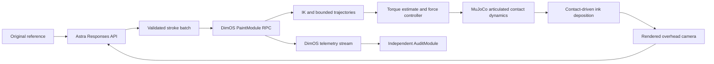

# maddie-bench / dim

A camera-feedback painting benchmark built with **Dimensional OS**, MuJoCo and the Anvil **OpenYAM** hardware model distributed in DimOS. Astra chooses physical pen strokes to reproduce the full original maddie-bench portrait. The arm executes them with torque-limited dynamics and contact-force control.

**Current status:** local simulation and DimOS integration tested on Apple Silicon macOS. The calibration demo is implemented; an actual Astra portrait run requires an API key. Physical transfer is **unverified**. This is a provisional simulator, not a calibrated digital twin. See [model provenance](docs/PROVENANCE.md) and [physical commissioning](docs/TRANSFER.md).

## Run locally

With Python 3.11 and [uv](https://docs.astral.sh/uv/) installed:

```sh
uv sync --locked --extra dev
uv run maddie-dim doctor
uv run pytest -q
uv run maddie-dim demo
uv run maddie-dim serve --port 0
```

The viewer prints a localhost URL. `--port 0` selects a free port. Rendering requires a logged-in macOS graphics session. DimOS starts two actual worker modules and a local Zenoh stream. No ROS installation or GPU service is required. The default demo runs faster than real time and does **not** call a model. `demo --realtime` uses real elapsed motion time.

For Astra, copy `.env.example` to `.env`, set `OPENAI_API_KEY` locally, and run:

```sh
uv run maddie-dim astra
```

`.env` is gitignored. Do not put the key in prompts, commands, screenshots or commits. Astra always uses real-time motion and a 1,800-second wall clock. The persistent ledger at `runs/budget-ledger.json` limits this project's API reservations to $100. Do not delete the ledger between experiments. A timeout retains its reservation because billing may have occurred.

## What is being evaluated

- Full composition and recognizable likeness from the exact original `reference-maddie-target.jpg`, copied as `assets/reference.jpg`.
- One black **POSCA PC-1MR**, already gripped, uncapped and primed. No picking up a pen or cap manipulation.
- White A4 sheet, **flat on the table**, taped at its corners. The **210 mm short edge faces the arm**; the 297 mm long dimension extends away. Coordinates use portrait image orientation, not the overview camera's perspective.
- Model input: reference image, rendered overhead camera and recent execution feedback. Output: up to 12 polylines per turn, each with speed and contact-force target. No digital fills, arbitrary brush widths, erasing, image tracing or image generation.
- Forces from 0.05–0.8 N are allowed targets, not guaranteed measured forces. Actual simulated contact makes the marks. Pressure changes darkness, continuity and a narrowly bounded width; that response is explicitly **uncalibrated**.
- The 30 minutes includes model thinking, API latency, planning, arm movement, camera inspections and parking. Setup is excluded. The controller preflights batch duration and stops when the wall clock expires.

The current output is an auditable portrait and operational metrics, **not an invented likeness score**. For comparison across models, use blinded human judging against the full reference, separate likeness/composition/mark-quality ratings, fixed settings, multiple seeds and retained failed attempts. Do not compare the controller coupon to portrait results.

## Architecture



`PaintModule` owns simulation, rendering and execution on one thread. `AuditModule` independently receives its DimOS output stream. A successful run checks that this stream delivered events. The registered `dimos.blueprints` entry point is `paint`; the benchmark CLI builds its run-specific blueprint through DimOS's `ModuleCoordinator`.

The native joint frames, axes, masses and inertia come from DimOS's **hardware gravity URDF**. The hand visuals use Anvil's actual gripper STEP geometry, tessellated to STL. The gripper assembly transform, pen dimensions, contact compliance, actuator friction and optics remain estimates. See the parameter table before interpreting results.

## Run evidence

Each directory under `runs/` contains:

| File | Evidence |
| --- | --- |
| `manifest.json` | Mode, config, source and reference hashes, timing, completion/failure |
| `paper.png` | Deposited marks, from actual simulated tip contact |
| `overhead.jpg`, `overview.jpg` | Actual rendered camera views |
| `trajectory.jsonl` | Joint commands/state, tip location, target/estimated/actual force |
| `physics.json` | Contact path, peak force, tracking and elapsed time |
| `dimos-events.jsonl` | Messages received by the independent DimOS subscriber |
| `turn-*/` | Astra request, observation, response and validated commands |

Optional run analysis and sampled video (requires `ffmpeg`):

```sh
uv run python scripts/analyze_run.py runs/RUN_ID
uv run python scripts/record_run.py runs/RUN_ID
```

Start the video script while a run is active. It records the actual saved camera views every two seconds at 12 fps (24× playback), labels its start time, and records that setup/earlier strokes may be absent. It does not reconstruct or synthesize unseen frames.

The viewer is read-only and binds to localhost. Runs and credentials are excluded from Git; a selected calibration example is retained in `examples/calibration/`. Physical-state ground truth is logged for evaluation, while Astra receives camera images and the controller's estimated-force feedback.

## Accuracy boundaries

The strongest current evidence is that this architecture runs on this Mac, controls a real dynamics simulation through DimOS, conserves physical coordinate conventions, and responds to force targets. It cannot prove the withheld hardware's kinematics, motor-torque calibration, nib behavior, camera optics or controller bandwidth. Those require manufacturer data and physical calibration. The upstream DimOS planning and gravity models have different provenance, so a successful simulation must not be described as proof of safe execution on an actual Anvil arm.

See [validation](docs/VALIDATION.md), [provenance](docs/PROVENANCE.md), [transfer](docs/TRANSFER.md), and [third-party notices](THIRD_PARTY.md).
